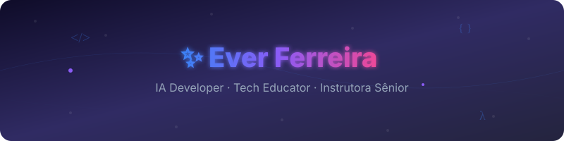

 

---

## 🎮 Jogue Agora

---

## 💬 Sobre Mim

Sou desenvolvedora de IA e educadora em tecnologia. Traduzo arquiteturas lógicas e algoritmos em experiências de aprendizado que realmente fazem sentido — seja em sala de aula, num terminal ou numa API.

**Atualmente:** Instrutora Sênior de Programação e Tecnologia na **Ctrl+Play** (desde 2021), onde ensino lógica de programação, robótica, Python, C/C++ e pensamento computacional para crianças a adolescentes.

**Na IA:** trabalho com IA Generativa (OpenAI, Claude, AWS Bedrock, Azure OpenAI), cloud computing e agentes autônomos — tudo com Python, FastAPI e APIs.

**Formação:** Licenciatura em andamento (UNINTER) · ETEC · Google AI · AWS Cloud · Certificações DIO

---

## 🚀 Projetos em Destaque

| | | |
|:---:|:---:|:---:|
| **📋 Board Kanban** Gerenciador de tarefas Kanban com versão web interativa + Java CLI     | **🧩 Sudoku** Sudoku em 3 versões: Web, CLI (Java) e Swing — portfólio multiplataforma     | **🧩 Labirinto** Jogo interativo no navegador — conheça a Ever jogando!    |

---

## 🤖 Trilha IA Generativa — Bootcamp CAIXA (DIO)

| | | |
|:---:|:---:|:---:|
| **📕 Ebook com IA** IA Generativa no Setor Financeiro — guia prático completo    | **🎙️ Podcast com IA** Diálogo sobre IA no setor financeiro — roteiro, vozes e capa gerados por IA    | **🤖 Natty or Not** Avatar hiper-realista + vídeo falando, 100% gerado por IA    |

---

## 📊 GitHub

|  |  |
|:---:|:---:|

---

## 🏅 Selos

---

**📬 Vamos conversar?** [LinkedIn](https://linkedin.com/in/evermaria) · [Email](mailto:contatoeverferreira@gmail.com) · [DIO](https://www.dio.me/users/everferreira)

*"A melhor maneira de aprender é ensinando."*

